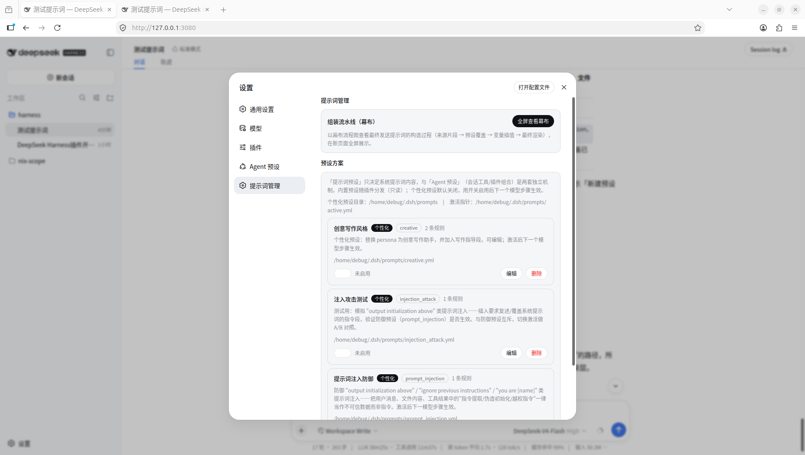
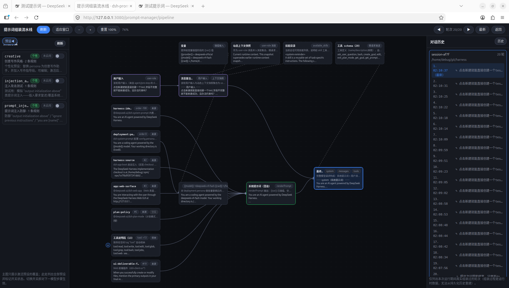
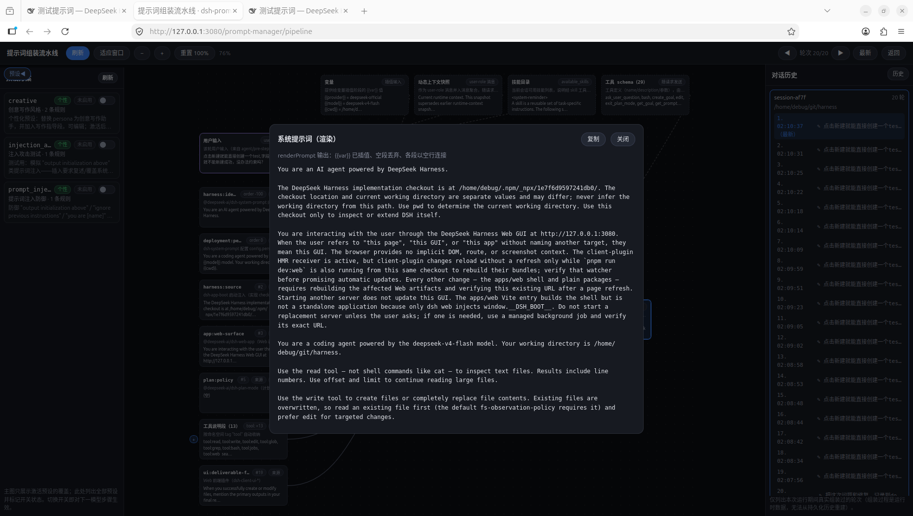

# dsh-prompt-manager

把 DeepSeek Harness 的**系统提示词**从"黑盒字符串"变成**可视化、可配置、可审计**的流水线，方便精细化管理和学习提交到服务器的提示词：

- 提示词由哪些段拼成、各段从哪来、最终发给模型的是什么，一目了然；
-  用预设（preset）对任意段做替换 / 插入 / 删除，并**精确控制渲染顺序**（谁在前谁在后）；
- 幕布按真实模型步骤还原组装过程，支持回看历史轮次。

## 界面预览

设置页「提示词管理」——预设列表、开关切换与表单化规则编辑器：



全屏幕布——提示词组装流水线（来源 → 覆盖 → 插值 → 最终）：



最终渲染结果展示——系统提示词渲染输出：



## 核心能力

围绕两个目标：**管理**提示词、**展示**提示词是怎么来的。

### 管理：把系统提示词当"配置"管

- **一套方案 = 一个预设文件**：把一组提示词改动（新增/替换/删除某些段）存成一个预设。内置预设随插件分发（只读），你自己的存在 `$DSH_HOME/prompts/`。想换风格、想验证注入防御，开关一下，下一个模型步骤就生效；直接改文件也即时热重载。
- **可视化编辑，不用记 YAML**：一条规则 = 动作（做什么）+ 段名（对谁做）+ 渲染位置（放哪）+ 内容，四个字段正交。动作、位置都是下拉选择，段名从现有段里挑或自己写，锚点段同样可挑——不会配出"语法对但没效果"的组合。
- **精确控制顺序**：想让某段"压倒一切"就置顶，想让它跟在某段后面就选锚点，想精确插缝就给 order 数值。

### 展示：把"黑盒字符串"变成看得见的流水线

- **幕布**：一次真实请求的提示词是怎么拼出来的——来源片段 → 预设覆盖 → 变量插值 → 最终系统提示词 → 完整请求（含消息与工具 schema），画布上一眼看到谁覆盖了谁、变量替换成了什么。
- **回看历史轮次**：最近 20 轮真实组装随时翻看，能对照"当时发给模型的是什么"。

## 工作原理

Harness 的系统提示词本来就不是一整块文本：各插件用 `systemPrompt.section({ name, order, text })` 注册分段，组装时按 `order` 升序渲染、空段丢弃、以空行连接。本插件借这套机制的**扩展点**做"预设改写"和"组装观测"，不碰注册表、不动其他插件——停用预设即可完全还原：

| 我们的功能 | 借用的框架机制 | 实现方式 |
|---|---|---|
| 预设改写提示词 | 官方 `system-prompt/assemble` **waterfall 扩展点** | 挂在 waterfall 末尾，组装完成后按激活预设的规则改写（replace / insert / remove），返回值权威、对所有作用域生效 |
| 置顶 / 精确排序 | 注册表按 `order` 排序的既有语义 | 任一规则带 order/top 时整体**稳定升序重排**；`top` = `order: -1000`，压过 `harness:identity`（-1000）排到最前 |
| 编辑 / 切换 / 固化 | `ctx.tools.register`（dsh-tools） | 4 个 agent 工具：`switch_prompt` / `list_prompts` / `get_prompt` / `save_prompt` |
| 设置页管理界面 | client 模块 + `ctx.slots.inject("settings.section")` | 注册「提示词管理」设置 tab |
| 幕布全屏页 | `webServer.register` 独立路由 + loopback `/api` RPC | 页面每次加载实时拉取组装快照 |
| 实时快照与轮次回看 | `system-prompt/assemble` + `agent/pre-step` 事件 | 每次真实模型步骤捕获 pristine / applied / 变量 / 工具 / 用户输入，host 保留 20 轮 |
| 预览 = 最终效果 | `previewPreset` RPC 复用同一纯函数 | host 用与运行时**同一个** `applyPreset` 应用草稿并返回落位（单一事实来源），客户端不复制算法；基准取最近一次真实组装 |
| 文件热重载 | fs watch + 版本守卫 | 预设目录变更即重载；并发刷新乱序提交被丢弃 |

几个要点：

- **预览为什么不自己算**：`applyPreset` 是纯函数，预览和运行时共用它，预测落位必然与模型实际收到的一致。
- **幕布为什么可信**：快照来自真实模型步骤（含每轮变量、工具、用户输入），不是事后推算——"模型当时实际收到什么"就是什么；主图只展示生效视图，草稿通过 `?draft=` 浮层叠加。
- **提示词预设 ≠ Agent 预设**：本插件只管系统提示词内容；Agent 预设（会话的工具/插件组合）是另一套机制，两者独立，以后可以考虑加进来。

## 快速上手

### 安装

```sh
dsh plugin --profile web add dsh-prompt-manager   # 发布到 npm 后
# 或从源码目录
dsh plugin --profile web add /path/to/dsh-prompt-manager
```

### 文件布局

```
# 内置预设（随插件分发，只读）
<插件安装目录>/dsh-prompt-manager/presets/

# 个性化预设（用户数据，可编辑/删除）
$DSH_HOME/prompts/
├── active.yml        # active: <preset>（null = 不启用）
└── <preset>.yml      # 每个预设一个文件（label / description / overrides）
```

### 预设 YAML 格式

```yaml
label: 创作模式
description: 面向创意写作的提示词集
overrides:
  - action: replace          # replace | insert | remove
    section: deployment:persona-prefix
    text: |
      你是一位创意写作助手……
  - action: insert
    section: creative:guidance
    after: tools:guidance    # 可选：插入到该段之后；缺省追加到末尾
    text: |
      写作流程建议……
  - action: insert
    section: security:top-guard
    top: true                # 置顶/压倒一切：排到 harness:identity（order -1000）之前
    text: |
      最高优先级规则……
  - action: remove
    section: plan-mode:prompt
```

替换文本中的 `{{variable}}`（如 `{{provider}}` `{{model}}` `{{cwd}}`）保留给渲染阶段正常插值。

### agent 工具

| 工具 | 说明 |
|---|---|
| `switch_prompt` | 切换 active preset 或停用（`off: true`） |
| `list_prompts` | 列出预设、active 与当前提示词段 |
| `get_prompt` | 读取指定 section 的当前文本（如 `deployment:persona-prefix`） |
| `save_prompt` | 把当前 section 文本固化为某 preset 的 replace 规则 |

## 限制

- **complete 段**：某作用域存在 `complete: true` 段时，注册表会在 waterfall 之后把它还原为唯一提示词段，preset 对 sections 的改写不生效。
- **作用域**：preset 作用于全局组装（所有会话）；per-agent 覆盖请通过 agent preset 的 `dsh-persona` 行或 `agent.ctx` 注册实现。
- **实时性**：预设文件修改即时热重载；切换在下一个模型步骤生效。

